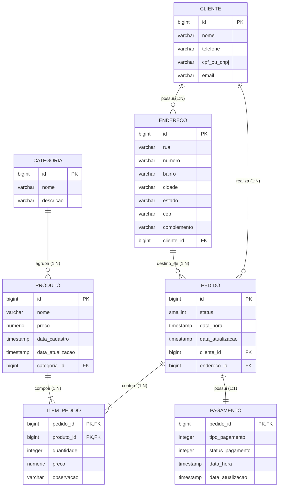

# 🍕 Pizzaria API

[](https://openjdk.org/projects/jdk/25/)
[](https://spring.io/projects/spring-boot)
[](https://spring.io/projects/spring-data-jpa)
[](https://www.postgresql.org/)
[](https://www.docker.com/)
[](http://localhost:8083/swagger-ui.html)
[](LICENSE)

A production-grade, domain-driven RESTful API for modern pizzeria operations, handling everything from product catalogs and customer relationship management to order lifecycle dispatching, delivery address routing, and payment tracking.

Built on the latest **Java 25** and **Spring Boot 4.x**, following clean enterprise architecture, immutable **Java Records** for data transfer objects (DTOs), and JPA/Hibernate relational persistence backed by PostgreSQL in containerized environments.

---

## 📑 Table of Contents

- [Core Features](#-core-features)
- [Architecture & Tech Stack](#-architecture--tech-stack)
- [Domain Model & Relational Mapping](#-domain-model--relational-mapping)
- [Project Structure](#-project-structure)
- [API Documentation & Endpoints](#-api-documentation--endpoints)
- [Getting Started](#-getting-started)
  - [Prerequisites](#prerequisites)
  - [1. Clone Repository](#1-clone-repository)
  - [2. Start Infrastructure (PostgreSQL & pgAdmin)](#2-start-infrastructure-postgresql--pgadmin)
  - [3. Run the Application](#3-run-the-application)
- [Automated Tests](#-automated-tests)
- [Git Commit Standards](#-git-commit-standards)
- [Author & License](#-author--license)

---

## 🌟 Core Features

- **Order Lifecycle Management:** Complete state transition machine for orders (`RECEBIDO` ➡️ `EM_PREPARO` ➡️ `NO_FORNO` ➡️ `EM_ROTA` ➡️ `ENTREGUE` or `CANCELADO`).
- **Selective Delivery Address Routing:** Support for customers registering multiple delivery addresses, with individual order routing linked to one selected target address.
- **Audit & Timestamps:** Entity lifecycle listeners (`@PrePersist`, `@PreUpdate`) maintaining strict auditing timestamps across orders, payments, and catalog items.
- **Strict Separation of Concerns (DTO Layer):**
  - **Creation DTOs (`dto_created`):** Type-safe, validated request payloads for writes.
  - **Response DTOs (`dto_response`):** Decoupled output projections preventing domain model leakage.
  - **Formatted Envelope Records (`responseDtoFormat`):** Structured JSON responses wrapping collections and single resources with clean JSON root property keys.
- **Interactive OpenAPI 3.0 Documentation:** Fully integrated Swagger UI for API exploration and payload testing.
- **Reproducible Containerized Setup:** Fully automated multi-container orchestration for PostgreSQL 17 and pgAdmin 4 via Docker Compose.

---

## 🛠️ Architecture & Tech Stack

| Layer / Concern | Technology | Description |
| :--- | :--- | :--- |
| **Language & Platform** | Java 25 | Utilizing modern language features (Java Records, Pattern Matching, Stream API) |
| **Framework** | Spring Boot 4.1.1 | Modern Spring framework baseline with optimized WebMVC stack |
| **Data Access / ORM** | Spring Data JPA / Hibernate 7.4.x | Relational mapping, composite primary keys, dirty checking, cascading |
| **Relational Database** | PostgreSQL 17 | Robust ACID relational database engine |
| **Containerization** | Docker & Docker Compose | Preconfigured DB and pgAdmin orchestration with health checks |
| **API Documentation** | Springdoc OpenAPI UI 2.8.5 | Swagger UI 3.0 specification auto-generated from controllers |
| **Build Automation** | Apache Maven 3.9+ | Wrapper-driven dependency and lifecycle management (`./mvnw`) |
| **Validation** | Jakarta Bean Validation | Declarative constraints (`@NotNull`, `@Size`, etc.) |

---

## 🗄️ Domain Model & Relational Mapping

The database schema is designed for relational consistency, referential integrity, and composite key mapping:



---

## 📂 Project Structure

```text
pizzaria-api/
├── compose.yml                              # Docker Compose infrastructure (Postgres + pgAdmin)
├── pom.xml                                  # Maven dependencies & build definitions
├── mvnw / mvnw.cmd                          # Maven Wrapper binaries
└── src/
    ├── main/
    │   ├── java/com/pizzaria/api/
    │   │   ├── config/                      # OpenAPI & Swagger configuration
    │   │   ├── controllers/                 # REST HTTP Controllers (Endpoints)
    │   │   ├── dto_created/                 # Request payload records (Input DTOs)
    │   │   │   └── responseDtoFormat/       # Formatted response envelope records
    │   │   ├── dto_response/                # Domain response projections (Output DTOs)
    │   │   ├── entities/                    # JPA Entities & Composite Keys (ItemPedidoPk)
    │   │   ├── enums/                       # Domain enumerations (StatusPedido, Pagamento)
    │   │   ├── repositories/                # Spring Data JPA Repository interfaces
    │   │   ├── services/                    # Business rules & Transaction management
    │   │   ├── TestConfig/                  # CommandLineRunner mock seed for development
    │   │   └── PizzariaApiApplication.java  # Spring Boot Main Entry Point
    │   └── resources/
    │       └── application.yaml             # Datasource, Hibernate & Server configurations
    └── test/                                # Integration and context load test suites
```

---

## 📡 API Documentation & Endpoints

When the application is running, the interactive Swagger documentation is available at:

- **Swagger UI:** [http://localhost:8083/swagger-ui.html](http://localhost:8083/swagger-ui.html)
- **OpenAPI 3.0 Specification:** [http://localhost:8083/v3/api-docs](http://localhost:8083/v3/api-docs)

### Primary Endpoints Reference

#### 🛵 Orders (`/pedidos`)
| Method | Endpoint | Description | Request / Query Params |
| :--- | :--- | :--- | :--- |
| `POST` | `/pedidos` | Creates a new order with items and payment | `PedidoCreatedDTO` (Body) |
| `GET` | `/pedidos` | Lists all registered orders | Returns `PedidoFormatLIstDTO` |
| `GET` | `/pedidos/{id}` | Fetches an order by its unique ID | Returns `PedidoFormatDTO` |
| `PATCH` | `/pedidos/{id}/` | Updates order lifecycle status & payment | `status`, `statusPagamento` (Params) |

#### 📍 Addresses (`/enderecos`)
| Method | Endpoint | Description | Request / Query Params |
| :--- | :--- | :--- | :--- |
| `POST` | `/enderecos` | Saves new addresses linked to a customer | `EnderecoCreatedDTO` (Body) |

#### 👤 Customers & Products (`/clientes`, `/produtos`, `/categorias`)
| Base Route | Description |
| :--- | :--- |
| `/clientes` | Customer profile management and lookup service |
| `/produtos` | Pizza catalog and menu item querying |
| `/categorias` | Product categorization and groupings |

---

## 🚀 Getting Started

### Prerequisites

Ensure you have installed:
- [Git](https://git-scm.com/)
- [Docker Engine & Docker Compose](https://www.docker.com/)
- [Java Development Kit (JDK) 25+](https://openjdk.org/projects/jdk/25/)

### 1. Clone Repository

```bash
git clone git@github.com:jailsonribeirodev-sys/pizzaria-api.git
cd pizzaria-api
```

### 2. Start Infrastructure (PostgreSQL & pgAdmin)

Run the container services in detached mode:

```bash
docker compose up -d
```

- **PostgreSQL Database:** Running on `localhost:5435`
  - Database: `pizzaria`
  - User: `postgres`
  - Password: `postgres`
- **pgAdmin 4 Web Console:** Accessible at [http://localhost:15435](http://localhost:15435)
  - Email: `jailson.ribeirodev@gmail.com`
  - Password: `admin`

### 3. Run the Application

Compile and launch the Spring Boot service via Maven Wrapper:

```bash
./mvnw spring-boot:run
```

The service will boot in approximately 3 to 4 seconds, listening on port **8083**:
- Application Root: `http://localhost:8083`
- Swagger UI: `http://localhost:8083/swagger-ui.html`

---

## 🧪 Automated Tests

Execute the automated test suites using the Maven wrapper:

```bash
# Run unit & integration tests
./mvnw test

# Compile and verify source code
./mvnw clean test-compile
```

---

## 📐 Git Commit Standards

This repository strictly enforces **Conventional Commits** (`v1.0.0`):

```text
<type>(<scope>): <short description>
```

### Supported Types:
- `feat`: A new feature or endpoint (e.g., `feat(controller): add address endpoints`)
- `fix`: A bug fix or runtime patch
- `refactor`: Code restructuring without functional behavior changes (e.g., `refactor(domain): ...`)
- `chore`: Tooling, build config, dependencies or repository maintenance (e.g., `chore: ignore swap files`)
- `docs`: Documentation updates or additions (e.g., `docs: update project README`)

---

## 👤 Author

**Jailson Ribeiro**
- GitHub: [@jailsonribeirodev-sys](https://github.com/jailsonribeirodev-sys)
- Email: [jailson.ribeirodev@gmail.com](mailto:jailson.ribeirodev@gmail.com)

---

## 📄 License

This project is open-source and distributed under the terms of the [MIT License](LICENSE).
