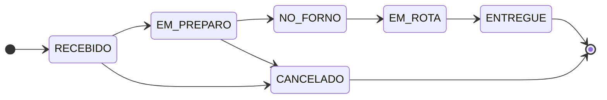

<div align="center">

# Pizzaria API

**RESTful backend service for pizzeria order management, delivery address routing, and payment processing.**

[](https://openjdk.org/projects/jdk/25/)
[](https://spring.io/projects/spring-boot)
[](https://hibernate.org/orm/)
[](https://www.postgresql.org/)
[](https://docs.docker.com/compose/)
[](http://localhost:8083/swagger-ui.html)

[Overview](#overview) · [Tech Stack](#tech-stack) · [Architecture & Data Model](#architecture--data-model) · [Getting Started](#getting-started) · [API Reference](#api-reference) · [Development](#development)

</div>

---

## Overview

**Pizzaria API** is a domain-driven REST API built with **Java 25** and **Spring Boot 4.1** that manages the core operational workflow of a pizzeria: product catalog organization, customer multi-address registration, order creation with line-item subtotals, and synchronized order/payment state transitions.

### Key Engineering Decisions

- **Strict DTO Boundary with Java Records**: Domain entities are never exposed directly over HTTP. Input payloads (`dto_created`), output projections (`dto_response`), and root JSON envelopes (`responseDtoFormat`) are modeled as immutable Java Records.
- **Selective Delivery Address Binding**: A customer (`Cliente`) can maintain a `Set<Endereco>` of multiple registered addresses, while each order (`Pedido`) is explicitly bound to a single target delivery address (`endereco_id`).
- **Composite Key Line Items**: Order items (`ItemPedido`) use an `@EmbeddedId` composite primary key (`ItemPedidoPk` combining `pedido_id` and `produto_id`), capturing historical unit price, quantity, notes, and computed subtotals at order time.
- **Automated Entity Auditing**: JPA lifecycle callbacks (`@PrePersist`, `@PreUpdate`) automatically maintain creation and last-modified timestamps across orders, payments, and products.

---

## Tech Stack

| Category | Technology | Version |
| :--- | :--- | :--- |
| **Language** | Java (OpenJDK) | `25` |
| **Framework** | Spring Boot (WebMVC, Validation, Data JPA) | `4.1.1` |
| **ORM** | Hibernate ORM | `7.4.x` |
| **Database** | PostgreSQL | `17` |
| **API Documentation** | SpringDoc OpenAPI (Swagger UI) | `2.8.5` |
| **Infrastructure** | Docker & Docker Compose (`postgres:17`, `pgadmin4`) | Latest |
| **Build Tool** | Apache Maven (via Maven Wrapper `./mvnw`) | `3.9+` |

---

## Architecture & Data Model

### Entity-Relationship Diagram


### Domain Enumerations & State Machine



| Enumeration | Values |
| :--- | :--- |
| **`StatusPedido`** | `RECEBIDO` (1), `EM_PREPARO` (2), `NO_FORNO` (3), `EM_ROTA` (4), `ENTREGUE` (5), `CANCELADO` (6) |
| **`TipoPagamento`** | `PIX` (1), `CARTAO_CREDITO` (2), `CARTAO_DEBITO` (3), `DINHEIRO` (4), `VALE_REFEICAO` (5) |
| **`StatusPagamento`** | `PENDENTE` (1), `PAGO` (2), `CANCELADO` (3) |

---

## Getting Started

### Prerequisites

- **JDK 25+** installed and configured in `PATH`
- **Docker** and **Docker Compose** running

### 1. Clone the Repository

```bash
git clone git@github.com:jailsonribeirodev-sys/pizzaria-api.git
cd pizzaria-api
```

### 2. Start Database Infrastructure

Launch PostgreSQL 17 and pgAdmin 4 in detached mode:

```bash
docker compose up -d
```

| Service | Host & Port | Credentials / Details |
| :--- | :--- | :--- |
| **PostgreSQL 17** | `localhost:5435` | Database: `pizzaria` · User: `postgres` · Password: `postgres` |
| **pgAdmin 4** | [http://localhost:15435](http://localhost:15435) | Email: `jailson.ribeirodev@gmail.com` · Password: `admin` |

### 3. Build and Run the Application

```bash
./mvnw spring-boot:run
```

On startup, the application:
1. Connects to PostgreSQL on port `5435` and initializes the schema.
2. Executes `testconfig` (`CommandLineRunner`) to seed initial data (`1 Customer`, `2 Categories`, and `2 Products`).
3. Starts the embedded Tomcat server on **[http://localhost:8083](http://localhost:8083)**.

### 4. Access Interactive API Docs (Swagger UI)

- **Swagger UI**: [http://localhost:8083/swagger-ui.html](http://localhost:8083/swagger-ui.html)
- **OpenAPI 3.0 JSON**: [http://localhost:8083/v3/api-docs](http://localhost:8083/v3/api-docs)

---

## API Reference

### Summary of Endpoints

| Method | Endpoint | Description | Response Status |
| :--- | :--- | :--- | :--- |
| `POST` | `/enderecos` | Register one or more addresses for a customer | `200 OK` |
| `POST` | `/pedidos` | Create a new order with items, address, and payment type | `201 Created` |
| `GET` | `/pedidos` | List all orders wrapped in a `pedidos` root envelope | `200 OK` |
| `GET` | `/pedidos/{id}` | Retrieve a single order by ID wrapped in a `pedido` envelope | `200 OK` / `404 Not Found` |
| `PATCH` | `/pedidos/{id}/` | Update order status and payment status | `200 OK` |

---

### 1. Register Customer Addresses

**`POST /enderecos`**

**Request Body:**
```json
{
  "clienteId": 1,
  "enderecos": [
    {
      "rua": "Santo André",
      "numero": "63",
      "bairro": "Ritinha",
      "cidade": "Santa Inês",
      "estado": "Maranhão",
      "cep": "65300000",
      "complemento": "Próximo à Ultragaz"
    }
  ]
}
```

**Response (`200 OK`):**
```json
{
  "enderecos": [
    {
      "idEndereco": 1,
      "rua": "Santo André",
      "numero": "63",
      "bairro": "Ritinha",
      "cidade": "Santa Inês",
      "estado": "Maranhão",
      "cep": "65300000",
      "complemento": "Próximo à Ultragaz"
    }
  ]
}
```

---

### 2. Create an Order

**`POST /pedidos`**

**Request Body:**
```json
{
  "idCliente": 1,
  "idEndereco": 1,
  "tipoPagamento": "PIX",
  "itensPedido": [
    {
      "idProduto": 1,
      "quantidade": 2,
      "observacao": "Sem cebola"
    },
    {
      "idProduto": 2,
      "quantidade": 1,
      "observacao": ""
    }
  ]
}
```
> If `observacao` is omitted or blank, the record compact constructor defaults it to `"Sem observações"`.

**Response (`201 Created`):**
```json
{
  "idPedido": 1,
  "status": "EM_PREPARO",
  "dataHora": "2026-10-21 16:00:00",
  "dataAtualizacao": "2026-10-21 16:00:00",
  "cliente": {
    "idCliente": 1,
    "nome": "Jailson Ribeiro",
    "cpfOuCnpj": "0894747588475",
    "email": "jailson@gmail.com",
    "telefone": "98984-764627"
  },
  "endereco": {
    "rua": "Santo André",
    "numero": "63",
    "bairro": "Ritinha",
    "cidade": "Santa Inês",
    "estado": "Maranhão",
    "cep": "65300000",
    "complemento": "Próximo à Ultragaz"
  },
  "pagamento": {
    "tipoPagamento": "PIX",
    "statusPagamento": "PENDENTE",
    "dataHora": "2026-10-21 16:00:00",
    "dataAtualizacao": "2026-10-21 16:00:00"
  },
  "itensPedido": [
    {
      "idProduto": 1,
      "nome": "Pizzaria",
      "quantidade": 2,
      "preco": 68.32,
      "observacao": "Sem cebola",
      "subtotal": 136.64
    },
    {
      "idProduto": 2,
      "nome": "Refrigerante",
      "quantidade": 1,
      "preco": 8.32,
      "observacao": "Sem observações",
      "subtotal": 8.32
    }
  ],
  "total": 144.96
}
```

---

### 3. Update Order & Payment Status

**`PATCH /pedidos/{id}/`**

**Request:**
```http
PATCH /pedidos/1/?status=NO_FORNO&statusPagamento=PAGO HTTP/1.1
Host: localhost:8083
```

---

### 4. Query Orders

- **`GET /pedidos/{id}`** — Returns the order wrapped in `{ "pedido": { ... } }`.
- **`GET /pedidos`** — Returns all orders wrapped in `{ "pedidos": [ ... ] }`.

---

## Project Structure

```text
src/main/java/com/pizzaria/api
├── config/                  # OpenAPI / Swagger configuration (OpenApiConfig)
├── controllers/             # REST controllers (PedidoController, EnderecoController, ...)
├── dto_created/             # Inbound request records (PedidoCreatedDTO, EnderecoCreatedDTO, ...)
│   └── responseDtoFormat/   # Root JSON envelope wrappers (PedidoFormatDTO, EnderecoFormatDTO, ...)
├── dto_response/            # Outbound response records (PedidoDTO, ClienteDTO, PagamentoDTO, ...)
├── entities/                # JPA entities (Pedido, Cliente, Endereco, Produto, Pagamento, ...)
│   └── pk/                  # Composite primary key classes (ItemPedidoPk)
├── enums/                   # Domain enums (StatusPedido, TipoPagamento, StatusPagamento)
├── repositories/            # Spring Data JPA repositories
├── services/                # Transactional business services (PedidoService, EnderecoService, ...)
├── TestConfig/              # Initial database seeding (testconfig)
└── PizzariaApiApplication.java
```

---

## Development

### Running Tests & Verification

```bash
# Compile source and test classes
./mvnw clean test-compile

# Run automated test suite
./mvnw test
```

### Commit Convention

Commits follow the **[Conventional Commits](https://www.conventionalcommits.org/)** specification:

```text
<type>(<scope>): <short summary in lowercase>
```

- **Types**: `feat`, `refactor`, `fix`, `chore`, `docs`, `test`
- **Scopes**: `domain`, `dto`, `service`, `controller`, `config`, `repo`

---

## Author

**Jailson Ribeiro**
- GitHub: [@jailsonribeirodev-sys](https://github.com/jailsonribeirodev-sys)
- Email: [jailson.ribeirodev@gmail.com](mailto:jailson.ribeirodev@gmail.com)
